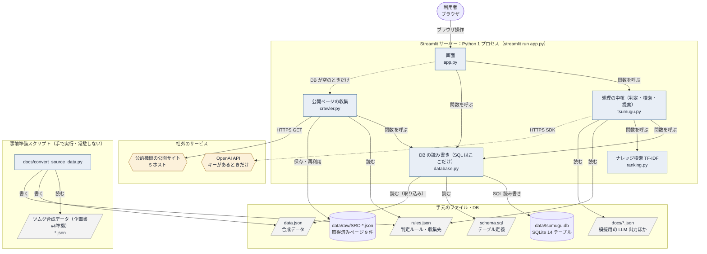
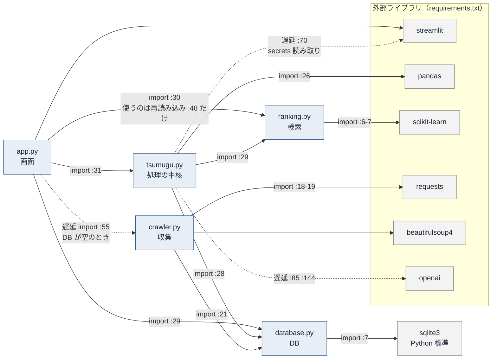
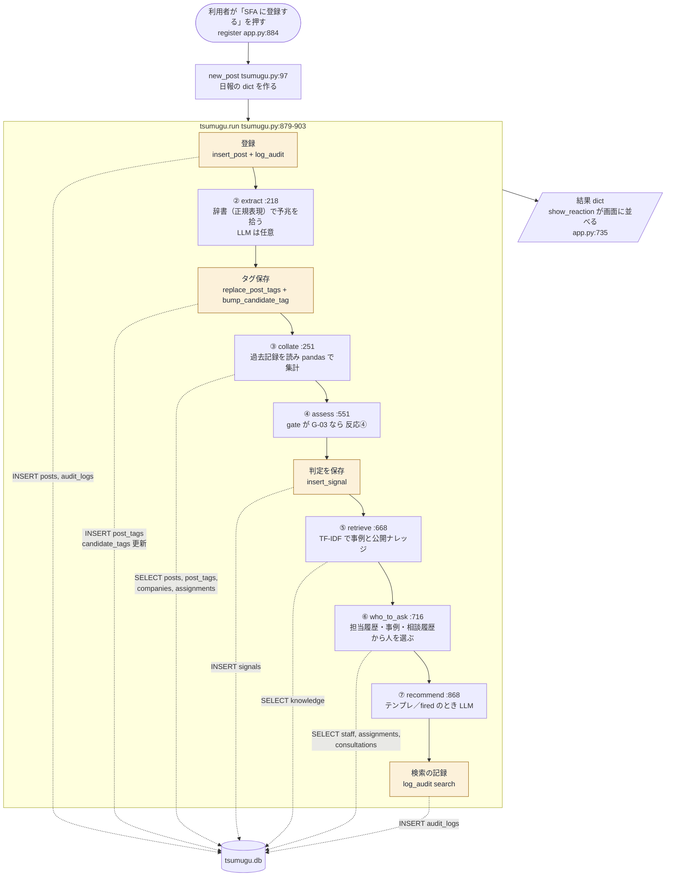
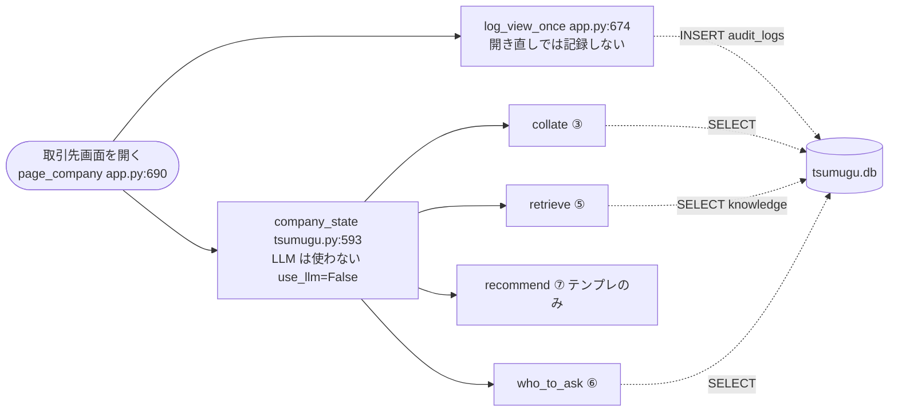
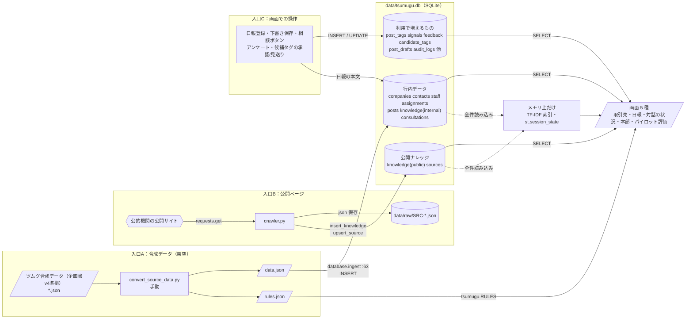
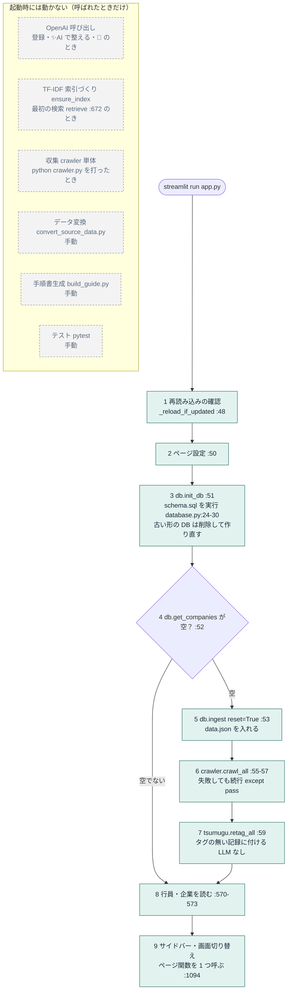
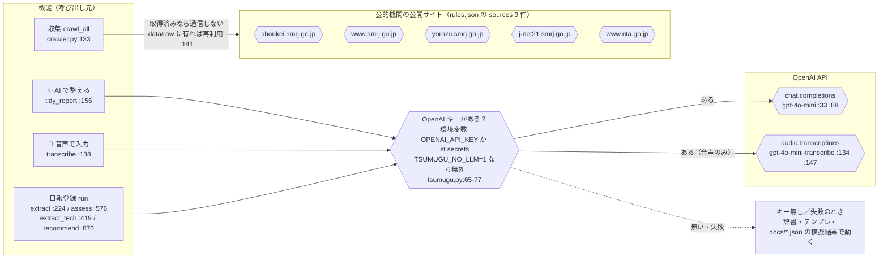

# 全体構成図：tsumugu_sf（ツムグ パイロット版）

- 対象: `Documents/Tech0/tsumugu_sf`（コード5本＋ `data/tsumugu.db` の実体＋ `rules.json` / `schema.sql` / `requirements.txt` / `.streamlit/` / `.devcontainer/` / `tests/`）
- 作成日時: 2026-09-29 22:01（JST）
- 読み手: この技術を学び始めたばかりの人（チームメンバー全員で同じ理解を持つため）
- 調査範囲: コード＋DB読み取り専用（アプリの起動・テスト実行・計測はしていない）。`OPENAI_API_KEY` など秘密情報の**値は読んでいない・書いていない**（キー名と置き場所だけ）

## 知りたい問い
1. 全体構成図（何でできているか）
2. 何が何を呼ぶか
3. データがどこから来てどこへ行くか
4. 起動時に動くもの・動かないもの
5. 外部通信

## 図の読み方（記号）
| 記号 | 意味 |
|---|---|
| 角丸の四角 | 人（利用者） |
| 四角 | プログラム（コードのファイル・関数） |
| 円筒 | データベース／保存されるファイル |
| 斜めの四角 | 設定・データのファイル（プログラムが読む） |
| 六角形 | 社外のサービス（外部通信の相手） |
| 実線の矢印 | 常に呼ぶ／常に読み書きする |
| 点線の矢印 | 条件つき（キーがある・DBが空・失敗しうる） |

---

## 図

### 図1　全体構成（まずこの1枚）
目的：「何でできているか」を一番粗い粒度で見る。

**レイヤー表**

| レイヤー | ファイル/モジュール | 責務 | 動く/動かない | 外部通信 |
|---|---|---|---|---|
| 画面 | `app.py`（1094行） | Streamlit で SFA 風の5画面を描く。結果の dict を並べる | 動く（`streamlit run`） | なし（直接は呼ばない） |
| 処理の中核 | `tsumugu.py`（919行） | 記録から予兆を拾う→照合→判定→ナレッジ検索→相談先→次の一手 | 動く（app.py から呼ばれる） | OpenAI（キーがあるときだけ） |
| 検索 | `ranking.py`（64行） | ナレッジを TF-IDF（文字 2〜3 gram）で検索 | 動く（呼ばれたとき） | なし |
| データ入出力 | `database.py`（441行）＋ `schema.sql` | SQLite への読み書き。SQL はこのファイルだけ | 動く（呼ばれたとき） | なし（ローカルファイル） |
| 収集 | `crawler.py`（162行） | 公的機関の公開ページを取得→`data/raw/`→DB | **通常は動かない**（DB が空のときだけ自動、または手動実行） | 公的機関の公開サイト |
| 設定 | `rules.json` | 予兆タグの辞書・判定のしきい値・収集先 URL | 動かない（読まれるだけ） | なし |
| データ | `data.json` / `data/raw/*.json` / `docs/*.json` | 合成データ・取得済みページ・模擬用の出力 | 動かない（読まれるだけ） | なし |
| DB 本体 | `data/tsumugu.db` | 14 テーブル | 動かない（読み書きされるだけ） | なし |
| 事前準備 | `docs/convert_source_data.py` | 合成データ → `data.json` / `rules.json` を生成 | **アプリ起動時には動かない**（手動） | なし |
| テスト | `tests/test_tsumugu.py` | 24 個のテスト関数 | 動かない（`pytest` を打ったとき） | なし |

---

### 図2　何が何を呼ぶか（ファイル同士の関係）
目的：ファイル間の「呼ぶ／呼ばれる」の向きを見る。矢印は「import している側 → される側」。

読み方のポイント：`database.py` と `ranking.py` は誰も呼び返さない（一番下の部品）。`app.py` は画面だけを持ち、判定は `tsumugu.py` に任せる（`app.py` 冒頭コメント :19）。

---

### 図3　日報を登録すると何が順に呼ばれるか
目的：一番重要な操作「SFA に登録する」で、どの関数が何の順に走り、DB のどこを読み書きするかを見る。

- 黄色の箱は DB に**書く**処理。それ以外は読むだけ。
- 同じ内容の日報を二度押ししたとき（`find_same_post`）は `run(persist=False)` で呼ばれ、**書き込み（黄色）は起きない**（`app.py:889-895`）。

### 図3b　取引先画面を開いたとき（読むだけ）
目的：図3との違い（DB にほぼ書かない）を見る。

---

### 図4　データはどこから来て、どこへ行くか
目的：データの「入口」「置き場所」「出口」を見る。

- 出口は**画面だけ**：`app.py` に `download_button` / `to_csv` / ファイル書き出しは見つからない（grep で確認）。
- 「行内データ」の `posts` は、合成データの日報（初期）と、画面で登録した日報（追加）が同じテーブルに入る。

---

### 図5　起動時に動くもの・動かないもの
目的：`streamlit run app.py` の直後に、何が動き何が動かないかを見る。

- 常駐するもの（スケジューラ・スレッド・バックグラウンド処理）は**コード中に見つからない**（`threading` `schedule` `while True` を検索、該当なし）。動くのは Streamlit のサーバーだけ。
- 起動時に DB が空でなければ、手順 5〜7（ingest・収集・タグ付け）は飛ばされる。手順 1〜4 と 8〜9 は毎回動く。

---

### 図6　外部通信（社外へ出ていく通信）
目的：どの機能が、どの条件で、社外のどこへ通信するかを見る。

- 通信の条件：`crawl_all` は `data/raw/SRC-*.json` が有れば再取得しない（`crawler.py:141-143`）。取得するときは 1 件ごとに 2 秒待つ・タイムアウト 10 秒（`rules.json` の `crawl`、`crawler.py:34,147`）。
- LLM は失敗しても例外を出さず `None` を返し、呼び出し側がテンプレに切り替える（`tsumugu.py:80-93`）。
- **通信しない**もの：SFA（Salesforce）。`app.py` は画面を「模す」だけで、Salesforce への接続コード・ライブラリは見つからない（`app.py:2,227,632` のコメント・文言と `requirements.txt` の一覧から）。DB は手元の SQLite ファイルで、ネットワーク越しではない。

---

## 問いへの回答

| 問い | 回答 | 根拠 | 確認 |
|---|---|---|---|
| 全体構成は？ | Streamlit の 1 プロセス（画面 app.py → 処理 tsumugu.py → DB database.py / 検索 ranking.py）＋ SQLite ファイル＋ JSON 設定。収集は別スクリプト crawler.py | `app.py:29-31`, `tsumugu.py:28-29`, `crawler.py:21` | 確認済み |
| 何が何を呼ぶか？ | app → tsumugu / database、tsumugu → database / ranking、crawler → database。database と ranking は誰も呼び返さない | 図2 の import 行 | 確認済み |
| 「日報登録」で呼ぶ順は？ | new_post → run（登録 → ② 抽出 → ③ 照合 → ④ 判定 → ⑤ 検索 → ⑥ 相談先 → ⑦ 提案） | `tsumugu.py:879-903` | 確認済み |
| データの入口は？ | ①合成データ（data.json）②公開ページ（crawler）③画面での操作 | `database.py:63`, `crawler.py:133`, `app.py:884` ほか | 確認済み |
| データの出口は？ | 画面のみ。ファイル書き出しやダウンロードは見つからない | `app.py` を grep（`download_button` `to_csv` なし） | 確認済み（検索範囲は app.py / tsumugu.py） |
| 起動時に動くのは？ | 再読み込み確認 → `init_db` は毎回。DB が空のときだけ ingest → crawl_all → retag_all | `app.py:48-59` | 確認済み |
| 起動時に動かないのは？ | OpenAI 呼び出し、TF-IDF 索引づくり、crawler 単体、convert/build_guide、テスト | `tsumugu.py:672`, `crawler.py:159`, 図5 | 確認済み |
| 常駐処理はあるか？ | 見つからない（スケジューラ・スレッド・無限ループなし） | `*.py` を grep | 確認済み（検索した範囲では見つからない） |
| 外部通信は？ | ①OpenAI（キーがあるときだけ）②公的機関 5 ホスト（DB が空／手動収集のときだけ） | `tsumugu.py:65-93,138-153`, `crawler.py:30-40`, `rules.json` の sources | 確認済み（ホスト名は sources の URL から） |
| Streamlit が操作のたびに app.py を頭から再実行する？ | そのように動く（`app.py` 末尾でページ関数を 1 つ呼ぶ構造と整合）。ただしコードだけでは確認できない | `app.py:1094` | **推測**（Streamlit の一般的な仕様） |
| 本番でどこにデプロイされているか？ | 不明。Codespaces 用の設定はある。README は「デプロイは main から」、`app.py:35` のコメントに Streamlit Cloud への言及 | `.devcontainer/devcontainer.json`, `README.md`, `app.py:35` | **不明**（実際の配置先は確認できない） |
| 処理時間・待ち時間は？ | 読み取りだけでは分からない | — | **不明（実行が必要）** |

### DB の実体（読み取り専用で確認・件数は 2026-09-29 時点のファイル）

| テーブル | 件数 | 備考 |
|---|---|---|
| assignments | 18 | 担当履歴 |
| audit_logs | 3 | 全て `view_company`（閲覧の記録） |
| candidate_tags | 2 | 候補タグ |
| companies | 10 | 取引先（架空） |
| consultations | 4 | 相談履歴 |
| contacts | 15 | 面談相手（`company_id` に FK あり） |
| feedback | 1 | アンケート回答 |
| knowledge | 33 | 内訳: 社内 case 6 / case_detail 6 / knowhow 12、公開 knowhow 2 / law 2 / option 5 |
| post_drafts | 0 | 下書き（未使用の状態） |
| post_tags | 19 | 正式 10 / 候補 5 / 価値 4。17 件の日報に付いている |
| posts | 79 | 日報 |
| signals | 0 | 判定の履歴（まだ 1 回も登録されていない状態） |
| sources | 9 | 収集先。全て `success` |
| staff | 10 | 行員 |

---

## 気づいた問題点・注意点
- **`init_db` が DB ファイルを消すことがある**：`posts` に `activity` 列が無い古い形の DB を見つけると、`data/tsumugu.db` を削除して作り直す（`database.py:24-30`）。コメントに「data.json と data/raw/ から毎回作れる」とあるが、**画面で登録した日報・相談・アンケートは data.json に無いので、この分岐で消える**。
- **どこからも呼ばれていない関数**：`tsumugu.pre_visit_summary`（:323）、`database.set_tag_confirmed`（:289）、`app.card_memos`（:507）。`tsumugu.draft_report`（:105）は `tests/` からしか呼ばれない（`app.py` は `tidy_report` を使う）。
- **外部キー制約は 2 本だけ**：`contacts → companies`、`post_tags → posts`（DB の `PRAGMA foreign_key_list`）。他のテーブル間（例：`posts.company_id`、`assignments.staff_id`）は ID の約束だけで DB は守っていない。加えて `PRAGMA foreign_keys` を有効にするコードは見つからない（SQLite の既定では外部キーは無効。一般知識で、実際の効き方は未確認）。
- **README とコードの数字のずれ**：README は「テスト 20 件」（`README.md`）だが、`tests/test_tsumugu.py` のテスト関数は 24 個。テストの成否は実行していないので不明。
- **DB の実体はほぼ未使用**：`signals` が 0 件のため、取引先画面の状態バッジは全社「①予兆は出ていません」から始まる（`company_state` は `db.get_last_signal` の結果でバッジを決める `tsumugu.py:593-`）。デモでは日報を登録して初めて変わる。
- **再実行のたびに DB 接続が増える作り**：`_rows` / `_exec` は呼び出しごとに接続を開いて閉じる（`database.py:38-50`）。小さな規模では問題になりにくいが、画面の再実行のたびに `init_db` と `get_companies` も走る（`app.py:51-52`）。

## 不明（実行が必要）として残した項目
- 実際の処理時間・待ち時間（`run` の `elapsed_sec` は実行しないと分からない）
- 本番（デプロイ先）の構成と、そこでの秘密情報の置き場所（このフォルダには `.streamlit/secrets.toml.example` だけがあり、実物の `secrets.toml` は無い。キー名は `OPENAI_API_KEY`）
- `pytest` の成否（`.pytest_cache/` はあるが、実行していないため結果は読んでいない）
